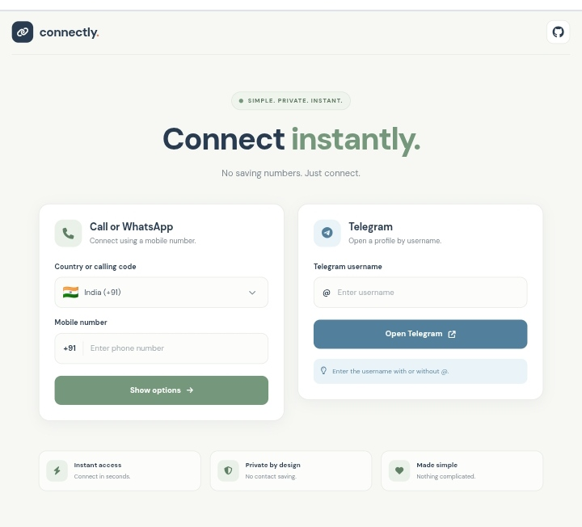
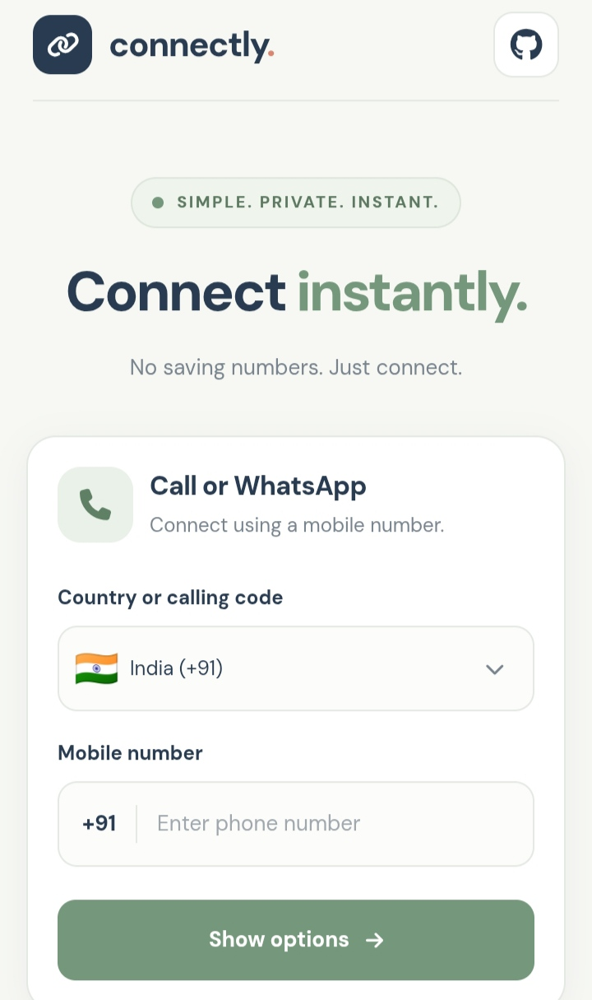
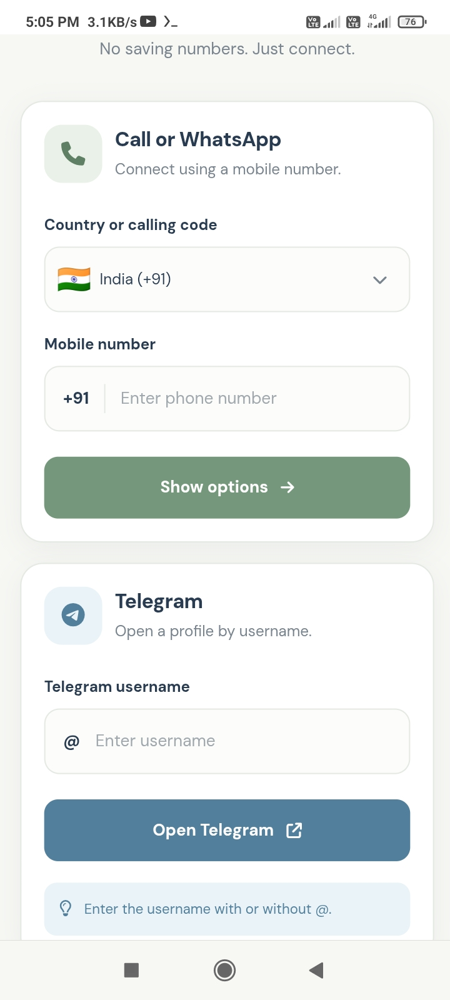

<div align="center">

# 🔗 Connectly

### Connect instantly. No saving numbers.

Connect through phone calls, WhatsApp, and Telegram without saving contacts.

<a href="screenshots/screenshot1.jpg"></a>


[Features](#-features) · [Screenshots](#-screenshots) · [Installation](#-installation) · [Usage](#-usage) · [Project Structure](#-project-structure) · [License](#-license)

</div>

---

## 📑 Table of Contents

- [About](#-about)
- [Features](#-features)
- [Screenshots](#-screenshots)
- [Tech Stack](#-tech-stack)
- [Installation](#-installation)
- [Usage](#-usage)
- [Project Structure](#-project-structure)
- [Privacy](#-privacy)
- [Author](#-author)
- [License](#-license)

## 🔗 About

Connectly is a lightweight, responsive web application for opening phone calls, WhatsApp conversations, and Telegram profiles. It helps users connect without saving phone numbers to their contacts.

## ✨ Features

- 🌍 Search countries by name, ISO code, or calling code.
- 🏳️ Display country flags and international dial codes.
- 📞 Generate direct phone-call links.
- 💬 Open WhatsApp conversations.
- ✈️ Open Telegram profiles by username.
- 🔎 Validate phone numbers and usernames.
- 📱 Responsive mobile and desktop interface.
- 📂 Load country information from JSON.

## 📸 Screenshots

<table>
<tr>
<td width="50%" align="center">
<strong>Screenshot 1 — Main Preview</strong><br><br>
<a href="screenshots/screenshot1.jpg"></a>
</td>
<td width="50%" align="center">
<strong>Screenshot 2</strong><br><br>
<a href="screenshots/screenshot2.jpg"></a>
</td>
</tr>
<tr>
<td colspan="2" align="center">
<strong>Screenshot 3</strong><br><br>
<a href="screenshots/screenshot3.jpg"></a>
</td>
</tr>
</table>

## 🧰 Tech Stack

- HTML5 and CSS3
- Vanilla JavaScript
- JSON country dataset
- Python 3 development server
- Font Awesome icons
- DM Sans typography

## ⚙️ Installation

Requirements: Python 3 and a modern web browser.

```bash
git clone https://github.com/pandeyujjwal975/connectly.git
cd connectly
python3 -m http.server 8080
```

Open http://127.0.0.1:8080 in your browser. Keep the terminal running while using the application. Press Ctrl+C to stop the server.

## 🚀 Usage

1. Open the country selector.
2. Search and select a country.
3. Enter the national phone number without repeating the country code.
4. Click Show options and choose Call or WhatsApp.
5. For Telegram, enter a username and click Open Telegram.

External applications may be needed to complete these actions.

## 📁 Project Structure

```text
connectly/
├── index.html
├── style.css
├── script.js
├── README.md
├── LICENSE
├── screenshots/
└── data/
    └── countries.json
```

## 🔐 Privacy

Connectly creates contact links without requiring users to save numbers. Calls and messaging are handled by external services, which apply their own privacy policies. The core frontend does not require a dedicated backend.

## 👨‍💻 Author

**Ujjwal Pandey**

[GitHub Profile](https://github.com/pandeyujjwal975)

## 📄 License

Distributed under the [MIT License](LICENSE).

---

<div align="center">

**Connectly** — Simple connections, made easier.

</div>
